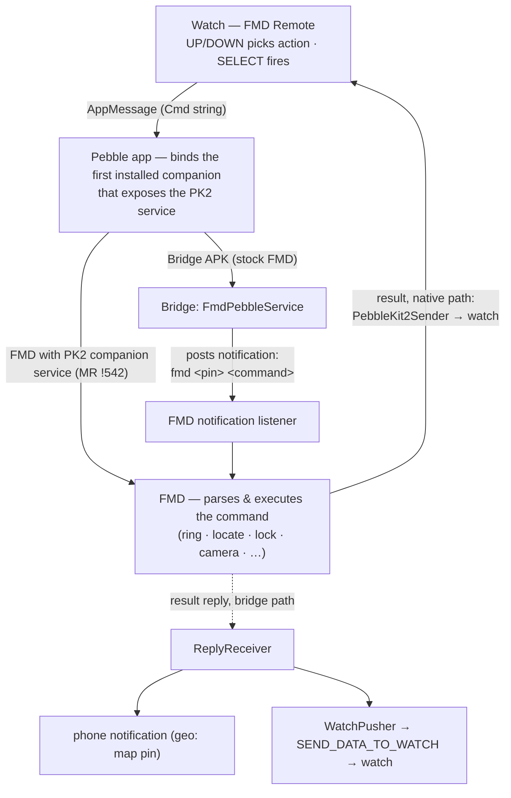

# fmd-smartwatch

Trigger [Find My Device (FMD)](https://gitlab.com/fmd-foss/fmd-android) commands
from a smartwatch — fully offline, over the watch's existing Bluetooth
connection to the phone. One repo per platform under one roof:

- **`android/`** — the bridge APK ("FMD Watch Bridge"). A ~25 KB gradle-free
  Android app. Trigger-based only: exported manifest receivers/services that
  Android spawns on demand. No persistent process, no server, no sockets.
- **`pebble/`** — "FMD Remote", the Pebble watchapp (C, SDK 3, all classic
  platforms). Action list: Ring / Locate (plain, last known, GPS) / Stats /
  Lock / Flash / Ringer mode / DND / BT scan / Camera (front + back) — short
  titles with small-text subtitles so nothing truncates on 144px screens.
- **`wear/`** — "FMD Remote" for Wear OS (Galaxy Watch 5+, planned — see
  `wear/README.md`).

The watch apps are the remotes; `android/` is the bridge that turns their
messages into FMD commands.

## Why a bridge APK? (it is not the goal)

The goal is **native FMD support** on every watch platform: FMD itself
receiving watch commands, with no third-party phone app in the loop. Until
FMD natively supports a given platform, the bridge APK fills the gap by
turning that platform's watch messages into the notification FMD already
trusts (`fmd <pin> <command>`). When a platform's native support lands and
ships in a release (Pebble: MR !542), that platform's remote talks to FMD
directly and the bridge is no longer needed for it.

Whether and how a platform gets native support is the FMD maintainers' call —
this repo does not presume the answer. It ships working remotes plus the
bridge today, and links native-support MRs here as they open.

## Platform status

| Platform | Remote | State | Native FMD support |
|---|---|---|---|
| Pebble (classic) | `pebble/` v1.5.1 | ✅ tested & working | [fmd-android MR !542](https://gitlab.com/fmd-foss/fmd-android/-/merge_requests/542) — draft open, pending review |
| Wear OS (GW5+) | `wear/` | 🚧 planned | none yet — would need a Wear/Play-Services dependency in FMD; maintainer decision |
| Garmin (Connect IQ) | — | idea | none |
| Bangle.js | — | idea | none |
| Amazfit (Zepp OS) | — | idea | none |

Until a platform's native support ships in an FMD release, that platform
needs the bridge APK.

## How it works (Pebble today)



FMD holds every privileged permission (max alarm volume, DND override, device
admin); the bridge is a dumb, permissionless trigger. The FMD notification
password lives in the bridge's settings (SharedPreferences), never in the
binary.

## FMD prerequisites (one-time)

1. FMD → Settings → enable **notification access**.
2. FMD → Access Control → create a **notification password** with the commands
   you want (Ring/Locate/Flash are in FMD's defaults; Lock needs its box
   ticked plus FMD's device admin).
3. Install the APK, open it once, set trigger word + password, Save.

## Install order (always)

1. If your FMD build does not yet include the PebbleKit 2 companion service
   (MR !542 pending — i.e., any stock release): sideload the bridge APK
   (`FMDRing.apk`). In-place updates keep settings.
2. Sideload the `.pbw` — **one pbw works for every setup**. Its companion list
   declares, in preference order: FMD release → FMD dev → the bridge APK.
   The Pebble app binds the first one that is installed *and* actually
   exposes the PK2 service (capability-probed). On phones with stock FMD that
   is the bridge; on FMD builds with MR !542 it is FMD itself.
3. Companion metadata is read **at install time** — if the watchapp fires but
   the phone stays silent, fully delete the watchapp in the Pebble app and
   re-sideload.

## Usage

- **Watch**: UP/DOWN picks an action, SELECT fires. Keep the watchapp open to
  receive results (coordinates, confirmations). Bind it to a quick-launch slot
  for two-press access.
- **Anything else on the phone** (Tasker, Termux, adb, another app):

```
adb shell am broadcast -a com.devinslick.fmdring.action.RING \
    -n com.devinslick.fmdring/.RingReceiver
# optional suffix, composed with trigger word + pin from settings:
#   --es command "locate"
```

- The persistent "Find phone" notification also works: select it on the watch
  or tap it on the phone.

## CI

`.github/workflows/build.yml` builds the artifacts on every push to `main`
and uploads them as run artifacts (`FMDRing-apk`, `fmd-remote-pbw`).

Local builds: `android/build.sh` (needs JDK 17 + Android SDK build-tools
34/platforms 34, paths overridable via `ANDROID_SDK`/`JAVA_HOME`) and
`pebble build` in `pebble/` (needs
[`pebble-tool`](https://developer.repebble.com/sdk/)).

## Security notes

- The `RING` receiver is exported and unauthenticated: any app on the phone
  can fire an FMD command (annoyance-only; the FMD pin never leaves the app).
- `android/debug.keystore` is committed so CI builds update in place over the
  installed app. **If this repo ever goes public, regenerate the keystore and
  strip the old one** — anyone holding it could sign matching updates.
- The PK2 companion wire contract (`io.rebble.pebblekit2.common` AIDL) is
  replicated from [pebble-dev/PebbleKitAndroid2](https://github.com/pebble-dev/PebbleKitAndroid2)
  (Apache-2.0) — a protocol reimplementation, no code copied.
- PK2 diagnostic notifications (settings checkbox) surface every hop as a
  notification; `adb logcat -s FMDRing` shows the same.
