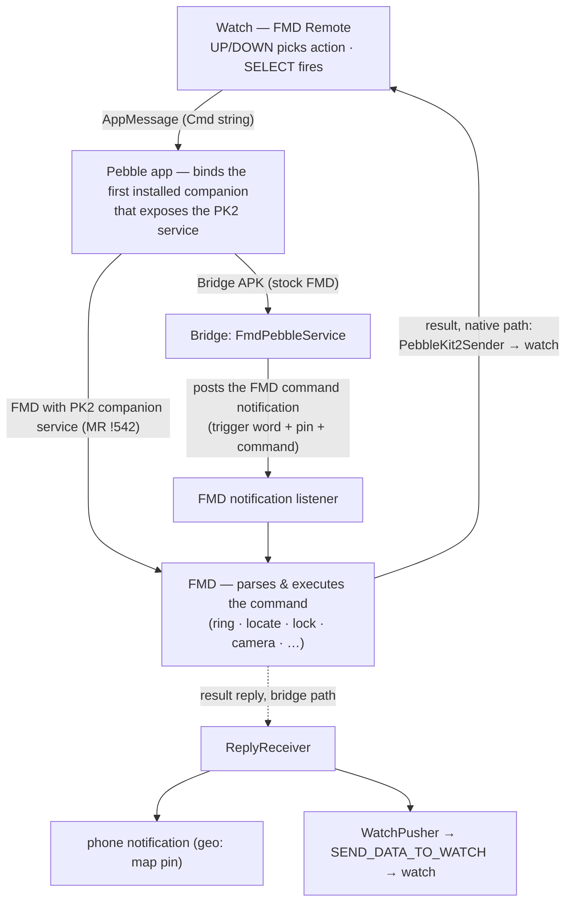

# fmd-smartwatch

Trigger [Find My Device (FMD)](https://gitlab.com/fmd-foss/fmd-android) commands
from a smartwatch — over the watch's existing link to the phone where one
exists (Pebble, Wear OS), or straight to your FMD Server where it doesn't
(watchOS). One repo per platform under one roof:

- **`android/`** — the bridge APK ("FMD Watch Bridge", `com.devinslick.fmdring`
  v0.8.0). Gradle-based since v0.8.0 (was gradle-free through v0.7.0) so it can
  absorb per-platform listeners: Pebble (PK2 companion service) + Wear OS
  (Data Layer listener) today, Garmin/Bangle/Zepp coming. Still
  trigger-based only — no persistent process beyond SDK-imposed listeners,
  no server, no sockets. One bridge APK for every platform until FMD
  natively supports each.
- **`pebble/`** — "FMD Remote", the Pebble watchapp (C, SDK 3, all classic
  platforms). Action list: Ring / Locate (plain, last known, GPS) / Stats /
  Lock / Flash / Ringer mode / DND / BT scan / Camera (front + back) — short
  titles with small-text subtitles so nothing truncates on 144px screens.
- **`wear/`** — "FMD Remote" for Wear OS (Galaxy Watch 5+): Kotlin watch app
  + Data Layer listener in a companion phone APK (`wear/README.md`).
- **`watchos/`** — "FMD Remote" for Apple Watch: standalone watch-only app
  that talks to an FMD Server directly (no bridge exists or is needed —
  `watchos/DESIGN.md`). Ships the cross-platform Swift protocol core
  (`fmd-server-core/`) today.
- **`garmin/`**, **`bangle/`**, **`zepp/`** — drafts for Connect IQ,
  Bangle.js, and Amazfit/Zepp OS: watch-app sources + bridge listeners
  (Garmin SDK listener and Bangle Gadgetbridge receiver ship in the bridge
  APK v0.9.0+; Zepp is cloud-mediated — the platform allows nothing local).
  Each has a README with its data flow and how-to-help; all need
  contributor hardware testing.

The watch apps are the remotes; `android/` is the bridge that turns their
messages into FMD commands.

## Why a bridge APK? (it is not the goal)

The goal is **native FMD support** on every watch platform: FMD itself
receiving watch commands, with no third-party phone app in the loop. Until
FMD natively supports a given platform, the bridge APK fills the gap by
turning that platform's watch messages into the notification FMD already
trusts (`fmd <pin> <command>`). When a platform's native support lands and
ships in a release (Pebble: MR !542), that platform's remote talks to FMD
directly and the bridge is no longer needed for it.

Whether and how a platform gets native support is the FMD maintainers' call —
this repo does not presume the answer. It ships working remotes plus the
bridge today, and links native-support MRs here as they open.

## Platform status

| Platform | Remote | State | Native FMD support |
|---|---|---|---|
| Pebble (classic) | `pebble/` v1.5.1 | ✅ tested & working | [fmd-android MR !542](https://gitlab.com/fmd-foss/fmd-android/-/merge_requests/542) — under active review |
| Wear OS (GW5+) | `wear/` v0.1.0 | 🚧 drafted, untested on-device | none yet — would need a Wear/Play-Services dependency in FMD; maintainer decision |
| Garmin (Connect IQ) | `garmin/` | 🚧 drafted — source + bridge listener; .prg compile blocked on login-gated device files (see `garmin/README.md`) | none |
| Bangle.js | `bangle/` | 🚧 drafted — app + Gadgetbridge-intent receiver; needs on-watch test | none |
| Amazfit (Zepp OS) | `zepp/` | 🚧 drafted — **cloud-mediated only** (no local path exists); relay + watch app; last hop needs design | none |
| watchOS (Apple Watch) | `watchos/` | 🚧 Swift protocol core implemented + tested (12/12); watch app not started (needs Xcode + hardware) | n/a — no phone link exists; the watch talks to the FMD server directly over its own LTE/Wi-Fi ([fmd-ios](watchos/DESIGN.md) would be the proper future entry, separate effort) |

Until a platform's native support ships in an FMD release, that platform
needs the bridge APK.

## How it works (Pebble today)



FMD holds every privileged permission (max alarm volume, DND override, device
admin); the bridge is a dumb, permissionless trigger. The FMD notification
password lives in the bridge's settings (SharedPreferences), never in the
binary.

## FMD prerequisites (one-time)

1. FMD → Settings → enable **notification access**.
2. FMD → Access Control → create a **notification password** with the commands
   you want (Ring/Locate/Flash are in FMD's defaults; Lock needs its box
   ticked plus FMD's device admin).
3. Install the APK, open it once, set trigger word + password, Save.

## Install order (always)

1. If your FMD build does not yet include the PebbleKit 2 companion service
   (MR !542 pending — i.e., any stock release): install the bridge APK
   (CI artifact `FMDRing-apk`). In-place updates keep settings. The same
   APK also carries the Wear OS listener.
2. Sideload the `.pbw` — **one pbw works for every setup**. Its companion list
   declares, in preference order: FMD release → FMD dev → the bridge APK.
   The Pebble app binds the first one that is installed *and* actually
   exposes the PK2 service (capability-probed). On phones with stock FMD that
   is the bridge; on FMD builds with MR !542 it is FMD itself.
3. Companion metadata is read **at install time** — if the watchapp fires but
   the phone stays silent, fully delete the watchapp in the Pebble app and
   re-sideload.

## Usage

- **Watch**: UP/DOWN picks an action, SELECT fires. Keep the watchapp open to
  receive results (coordinates, confirmations). Bind it to a quick-launch slot
  for two-press access.
- **Anything else on the phone** (Tasker, Termux, adb, another app):

```
adb shell am broadcast -a com.devinslick.fmdring.action.RING \
    -n com.devinslick.fmdring/.RingReceiver
# optional suffix, composed with trigger word + pin from settings:
#   --es command "locate"
```

- The persistent "Find phone" notification also works: select it on the watch
  or tap it on the phone.

## CI

`.github/workflows/build.yml` builds the artifacts on every push to `main`
and uploads them as run artifacts (`FMDRing-apk`, `fmd-remote-pbw`,
`fmd-remote-wear`).

Local builds:
- `android/`: `./gradlew assembleDebug` (JDK 21 + Android SDK platform 34;
  `local.properties` with `sdk.dir`; same debug keystore → in-place updates)
- `pebble/`: `pebble build` (needs
  [`pebble-tool`](https://developer.repebble.com/sdk/))
- `wear/`: `./gradlew assembleDebug` (JDK 21 + Android SDK platform 34;
  `local.properties` with `sdk.dir`)
- `watchos/fmd-server-core/`: `swift test` (Swift 6.1.2; works on Linux —
  Argon2 is vendored C, crypto via swift-crypto)

## Security notes

- `RING` receiver is exported and unauthenticated: any app on the phone
  can fire an FMD command (annoyance-only; the FMD pin never leaves the app).
- **Signing**: no keystore is committed (public repo). CI decodes a
  keystore from the `ANDROID_KEYSTORE_BASE64` repo secret so official
  builds update installed apps in place; contributors' local builds fall
  back to AGP's default debug keystore (different signature — remove the
  installed app before installing a local build over it). Set
  `FMD_KEYSTORE_FILE` to sign local builds with your own key.
- The Garmin Connect IQ SDK AAR is fetched at build time
  (`android/fetch-garmin-aar.sh`, pinned snapshot) — Garmin's binary is
  not redistributable, so it is never committed.
- The PK2 companion wire contract (`io.rebble.pebblekit2.common` AIDL) is
  replicated from [pebble-dev/PebbleKitAndroid2](https://github.com/pebble-dev/PebbleKitAndroid2)
  (Apache-2.0) — a protocol reimplementation, no code copied.
- PK2 diagnostic notifications (settings checkbox) surface every hop as a
  notification; `adb logcat -s FMDRing` shows the same.
