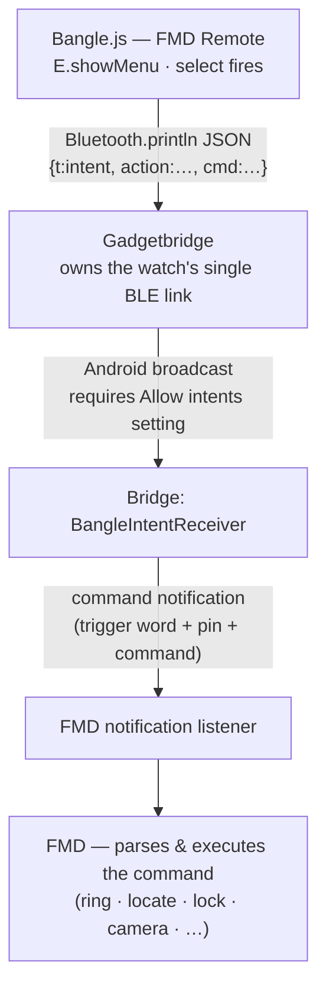

# bangle/ — FMD Remote for Bangle.js (draft)

Bangle.js 1 & 2 (Espruino JS). No build step — plain JS uploaded via the
App Loader.

## Transport (why this design)

Bangle.js exposes a single BLE connection, owned by **Gadgetbridge** (the
FOSS companion app most Bangle users run). Instead of fighting for the
link, the app rides Gadgetbridge's documented intent-forwarding: the watch
sends `{t:"intent", ...}` JSON lines, Gadgetbridge fires them as real
Android broadcasts (needs its experimental **"Allow intents"** setting
enabled). The bridge APK receives the broadcast and posts the FMD command
notification.

Result feedback: Gadgetbridge intents are one-way; the phone's FMD result
notification is the feedback surface for now.

## What exists vs what's needed

- ✅ Watch app (`app.js`): full command menu, sends via
  `Bluetooth.println`, emulator-friendly guard
- ✅ Bridge receiver (`android/` v0.9.0+): `BangleIntentReceiver` on
  action `com.devinslick.fmdring.action.BANGLE`, reads the `cmd` extra
- ⬜ On-watch test with a real Gadgetbridge install (contributor)
- ⬜ Optional: result path via a Gadgetbridge-adjacent design (ideas
  welcome)

## How to test without hardware

Paste `app.js` into the [Espruino Web IDE](https://www.espruino.com/ide)
emulator, or the [App Loader emulator](https://banglejs.com/apps?emulator)
— the menu renders and the "No Bluetooth" guard fires. The Gadgetbridge
half needs a real phone.

## How to help

- Bangle.js + Gadgetbridge + FMD: enable "Allow intents" in Gadgetbridge
  settings (also add the action to the allowed-actions list if your
  Gadgetbridge version uses one), install the bridge APK from CI, load the
  app from this folder via the App Loader's custom-app path, and report
- Better icon, Bangle.js 1 layout tweaks, a launcher entry
