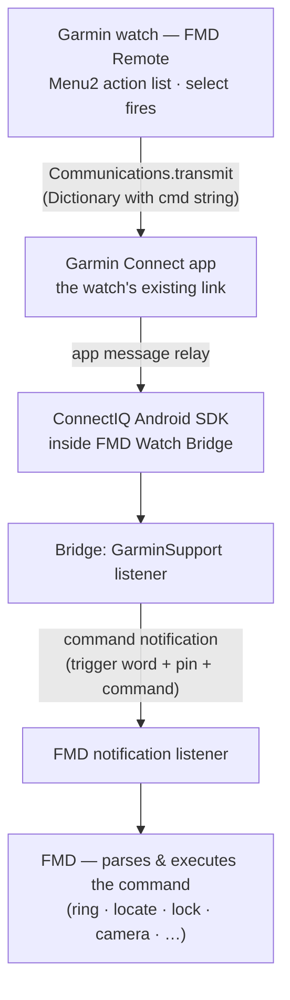

# garmin/ — FMD Remote for Connect IQ (draft)

Garmin watches (any Connect IQ device with a paired phone — fenix, venu,
vivoactive, forerunner, epix generations). Monkey C watch app + a listener
in the main bridge APK.

## Transport (why this design)

The watch's BLE link is owned by **Garmin Connect**, and Garmin's Connect IQ
Mobile SDK lets a third-party Android app receive watch-app messages through
it — the same local-bridge trust model as Pebble/Wear: offline, credentials
phone-side, FMD upstream untouched.



## What exists vs what's needed

- ✅ Watch app source (`source/`): Menu2 with the standard command list,
  `Communications.transmit`, result toasts via
  `registerForPhoneAppMessages`
- ✅ Bridge listener (`android/` v0.9.0+): `GarminSupport` initializes the
  ConnectIQ SDK lazily (MainActivity/boot) and posts the FMD command
  notification on `{"cmd": "..."}` payloads. App UUID is pinned on both
  sides: `adfb5368-67db-463f-91e5-4d45341f5c09`
- ⬜ **Compile of the .prg requires Garmin device files, which are
  login-gated** (even though the SDK itself is a public download). One-time
  unblock with a free Garmin account:
  ```sh
  make sdk                                   # public SDK download
  curl -s https://raw.githubusercontent.com/lindell/connect-iq-sdk-manager-cli/master/install.sh | sh
  connect-iq-sdk-manager-cli login           # free account
  connect-iq-sdk-manager-cli agreement accept
  make devices                               # device files → ~/.Garmin/ConnectIQ/Devices
  make build                                 # → build/fmd-remote-<device>.prg
  ```
- ⬜ On-watch testing (contributor with any paired Garmin), result send-back
  (`sendMessage` phone→watch), real app icon

## How to help

- You own a Garmin watch + Android phone: install the bridge APK from CI,
  build the `.prg` (`make sdk devices build`), sideload via Garmin Express
  or the SDK's `monkeydo`, and report what happens on Ring
- Icon design (61×61 png), more device targets in `manifest.xml`, a
  CI job that builds the .prg with stored Garmin credentials
