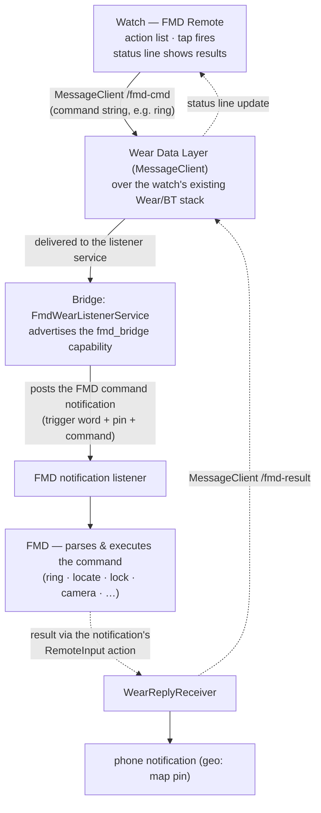

# wear/ — FMD Remote for Wear OS (draft)

Galaxy Watch 5+ / any Wear OS 3+ watch. Two gradle modules:

- **`app/`** — the watch APK (`com.devinslick.fmdremote.watch`, "FMD Remote").
  Plain view-based UI: status line + the same action list as the Pebble
  remote. Sends raw command suffixes on `/fmd-cmd` via the Wear Data Layer
  (`MessageClient`); displays results arriving on `/fmd-result`. Holds no
  credentials.
- **`bridge/`** — the phone APK (`com.devinslick.fmdwearbridge`, "FMD Wear
  Bridge"). A `WearableListenerService` advertising the `fmd_bridge`
  capability receives commands, composes trigger word + pin + command, and
  posts the notification FMD trusts (ported from the fmdring bridge's
  Notifier/ReplyReceiver; results flow back through the notification's
  RemoteInput and are forwarded to the watch). Holds the trigger word + pin
  in its settings.

## Data flow

## Why a second phone app (for now)

The fmdring bridge (`android/`) is gradle-free by design; the Wear Data
Layer needs `play-services-wearable` with a transitive AAR tree, which is
impractical without gradle. Draft decision: keep fmdring untouched, ship the
wear bridge as its own module. Consolidation options (fold into fmdring via
gradle conversion, or keep separate) are open; nothing depends on the choice.

Local build: `cd wear && ./gradlew assembleDebug` (JDK 21 + Android SDK
platform 34; `local.properties` with `sdk.dir`). CI: `wear` job in
`.github/workflows/build.yml`, artifacts under `fmd-remote-wear`.
