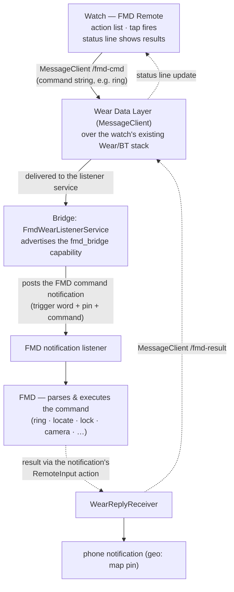

# wear/ — FMD Remote for Wear OS (draft)

Galaxy Watch 5+ / any Wear OS 3+ watch. One gradle module:

- **`app/`** — the watch APK (`com.devinslick.fmdremote.watch`, "FMD Remote").
  Plain view-based UI: status line + the same action list as the Pebble
  remote. Sends raw command suffixes on `/fmd-cmd` via the Wear Data Layer
  (`MessageClient`); displays results arriving on `/fmd-result`. Holds no
  credentials.

The phone side is the **main bridge APK** (`android/`, "FMD Watch Bridge")
— its `WearableListenerService` advertises the `fmd_bridge` capability,
composes trigger word + pin + command, posts the notification FMD trusts,
and forwards results back to the watch. One bridge APK serves every
platform (Pebble + Wear today; Garmin/Bangle/Zepp listeners coming).

## Data flow

## Bridge consolidation (v0.8.0)

The wear draft originally shipped a separate phone APK
(`com.devinslick.fmdwearbridge`) because the Wear Data Layer needs
`play-services-wearable` — an AAR tree that doesn't fit a gradle-free
build. As of bridge **v0.8.0** the main bridge (`android/`) is
gradle-based and absorbs every platform listener; the separate wear
bridge APK is retired. Same package + keystore as always, so it updates
in place.

Local build: `cd wear && ./gradlew :app:assembleDebug` (JDK 21 + Android
SDK platform 34; `local.properties` with `sdk.dir`). CI: `wear` job in
`.github/workflows/build.yml`, artifacts under `fmd-remote-wear`.
