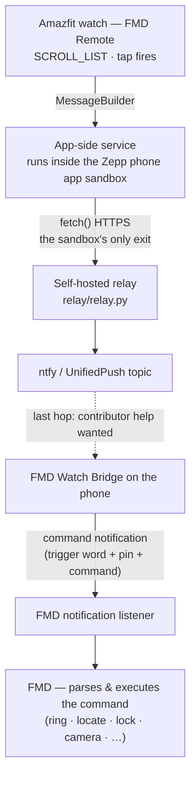

# zepp/ — FMD Remote for Amazfit / Zepp OS (draft)

Amazfit watches running Zepp OS 3.x.

## Transport reality (read this first)

**There is no local path.** Verified against Zepp OS 3 documentation:
the watch's Bluetooth link is owned by the Zepp phone app; third-party
mini apps get no raw BLE, no sockets, and no companion-APK binding. The
only sanctioned IPC is the `MessageBuilder` channel between the watch app
and its **app-side service** — JS running inside the Zepp app's sandbox —
and that service's only way out is `fetch()` over the internet.

So Amazfit is **cloud-mediated by design** (the only platform in this repo
where that's true — Pebble/Wear/Garmin/Bangle are all local; watchOS is
server-direct from the watch itself):

## What exists vs what's needed

- ✅ Watch app (`app.js`): SCROLL_LIST command menu → MessageBuilder
- ✅ App-side service (`app-side/index.js`): token-authenticated relay POST
- ✅ Reference relay (`relay/relay.py`, stdlib-only): validates a token,
  forwards to an ntfy topic
- ⬜ `appId` requires a (free) developer account at
  [dev.zepp.com](https://dev.zepp.com); scaffold with `zeus create` and
  slot these files in, or contribute the generated boilerplate back
- ⬜ **The last hop**: getting the relayed command from ntfy into the
  bridge without a persistent process. Options to evaluate (help wanted):
  ntfy app's per-subscription broadcast forwarding into a bridge receiver,
  or a UnifiedPush endpoint reusing the distributor FMD-server users
  already have
- ⬜ On-watch testing (contributor with an Amazfit + Zepp app in developer
  mode)

## How to help

- You own an Amazfit: free dev account → `zeus create` → port these files
  → `zeus dev` against your watch with the relay running
- Design the last hop (Android dev): ntfy broadcast receiver vs UnifiedPush
  registration in the bridge — pick one, ship it
- Relay hardening: rate limiting, per-device tokens
